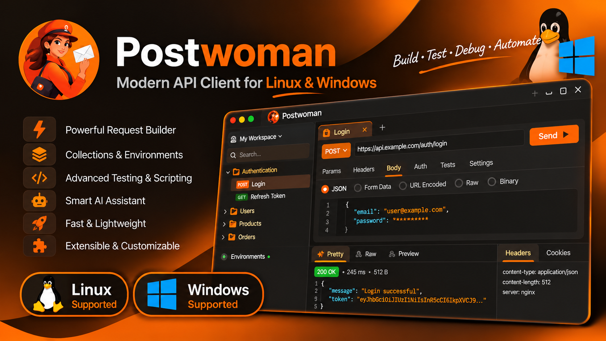

<p align="center">
  
</p>

<h1 align="center">Postwoman</h1>

<p align="center">
  A desktop API development platform for building, sending, testing and documenting HTTP APIs.
  <br />
  <a href="https://github.com/mtafakori1993/postwoman/releases/latest"><b>Download the latest release</b></a>
  · <a href="#windows">Windows</a>
  · <a href="#linux">Linux</a>
  · <a href="#build-from-source">Build from source</a>
</p>

<p align="center">
  <a href="https://github.com/mtafakori1993/postwoman/releases/latest"></a>
  <a href="https://github.com/mtafakori1993/postwoman/actions/workflows/release.yml"></a>
  <a href="LICENSE"></a>
  
</p>

<!-- version:start -->
**Current version:** `1.4.1`
<!-- version:end -->

> Windows 10/11 x64 and Linux x86_64 are the supported release platforms. macOS is
> not part of the release pipeline.

## Contents

- [Overview](#overview)
- [Features](#features)
- [Download](#download)
- [Windows](#windows)
- [Linux](#linux)
- [Where your data lives](#where-your-data-lives)
- [Usage](#usage)
- [AI assistant and providers](#ai-assistant-and-providers)
- [API Discovery Agent](#api-discovery-agent)
- [Import and export](#import-and-export)
- [Keyboard shortcuts](#keyboard-shortcuts)
- [Build from source](#build-from-source)
- [Release pipeline](#release-pipeline)
- [Versioning and releasing](#versioning-and-releasing)
- [Project layout](#project-layout)
- [Tech stack](#tech-stack)
- [Contributing](#contributing)
- [License](#license)

## Overview

Postwoman is a native desktop API client built with Go and React. It runs locally,
stores everything in SQLite, and never sends request data anywhere unless you
explicitly invoke an AI feature. It covers the full request lifecycle: compose and
send requests, organise them in collections and environments, inspect and test
responses, run scripts, mock APIs, open WebSocket sessions, and import/export
Postman, OpenAPI/Swagger and HAR documents.

The application ships in two Windows formats and two Linux formats:

| Platform | Format | Best for |
| --- | --- | --- |
| Windows | Installer (`setup.exe`) | A normal installation with Start Menu integration and upgrades |
| Windows | Portable ZIP | Running from any writable folder or USB drive without installation |
| Linux | Debian package (`.deb`) | Integrated installation on Debian/Ubuntu |
| Linux | AppImage | A single portable executable |

## Features

### Requests and responses
- Every HTTP method plus custom methods, query parameters, path variables,
  headers and a complete request-body editor.
- Body modes: none, raw, JSON, XML, text, JavaScript, HTML, form data
  (`multipart/form-data` with multi-file upload), URL encoded, binary and GraphQL.
- JSON/XML validation, formatting and minification; GraphQL introspection and
  query validation.
- Response views: pretty, raw and preview (HTML, images, PDF, audio, video, XML),
  plus headers, cookies, metadata, tests and console output.
- JSONPath extraction, response diffing, JSON Schema generation/validation, and
  copy-as-cURL.

### Collections, environments and auth
- Collections, nested folders, favourites, drag-and-drop reordering and per-collection
  variables/auth.
- Global, collection and environment variable scopes with `{{variable}}`
  interpolation, autocomplete, secret masking and variable inspection.
- Authentication: Basic, Bearer, API Key, Digest, OAuth 1.0, OAuth 2.0
  (authorization code, PKCE, client credentials, password, refresh token),
  AWS SigV4 and JWT, with request → folder → collection inheritance.
- Cookie manager, request history, mock servers and WebSocket sessions.

### Automation and interoperability
- Pre-request and test scripts with a Postman-style `pm.*` API.
- Collection runner with iterations and per-request results.
- Import/export of Postman collections and environments, OpenAPI 3, Swagger 2,
  HAR and cURL.
- Command palette, customisable keyboard shortcuts, light/dark/system themes,
  accent colours, compact mode and layout presets.

### AI-assisted workflows
- One central AI provider configuration shared by every feature.
- AI assistant presets for explaining requests, errors and responses, generating
  tests and JSON Schema, and suggesting improvements.
- Optional AI enrichment for the API Discovery Agent.
- Anthropic, OpenAI, Google Gemini, Azure OpenAI, Ollama and custom
  OpenAI-compatible providers are supported.

### API Discovery Agent
- Scans a local project and discovers routes, handlers, parameters, request bodies,
  response schemas, authentication requirements and related endpoints.
- Understands common JavaScript/TypeScript, Python, Go, PHP, Ruby, Java/Kotlin,
  C#, Rust and Elixir route styles, plus OpenAPI/Swagger/AsyncAPI documents.
- Reviews findings before import, with confidence scores, source snippets and
  editable names/folders/descriptions.
## Download

All downloads are attached to the **[latest GitHub release](https://github.com/mtafakori1993/postwoman/releases/latest)**.
Every release includes `SHA256SUMS.txt` for integrity verification.

### Windows Installer — recommended

**File:** `Postwoman-v<version>-windows-x64-setup.exe`

A standard per-user installation. No administrator privileges are required.

- Installs under `%LOCALAPPDATA%\Programs\Postwoman`.
- Lets you choose the installation directory.
- Creates a Start Menu shortcut and an optional desktop shortcut.
- Installs the Microsoft WebView2 Runtime when it is missing.
- Registers the application with Windows so it appears in **Settings → Apps**.
- Upgrades overwrite the previous installation without leaving duplicate entries.
- User data in `%APPDATA%\Postwoman` is preserved across upgrades and uninstalls.

### Windows Portable — no installation

**File:** `Postwoman-v<version>-windows-x64-portable.zip`

Recommended when you want to run Postwoman from a folder or USB drive.

- Extract the whole archive to a writable location and run `Postwoman.exe`.
- No installer and no administrator privileges.
- The included `portable.txt` marker keeps the database and WebView2 cache in the
  adjacent `data` folder, so the entire setup travels with the folder.
- The WebView2 bootstrapper is embedded in the executable and is used only if the
  runtime is missing.

### Linux

- **Debian/Ubuntu:** `postwoman_<version>_amd64.deb`
- **Portable:** `Postwoman-<version>-x86_64.AppImage`

Both are built for x86_64 and require GTK 3 and WebKitGTK 4.1.

## Windows

### Installer

1. Download `Postwoman-v<version>-windows-x64-setup.exe` from the latest release.
2. Run it and choose an installation directory if the default is not suitable.
3. Select whether you want a desktop shortcut (the Start Menu shortcut is always
   created).
4. Launch Postwoman from the Start Menu or the optional desktop shortcut.

If Windows SmartScreen warns about an unsigned executable, verify
`SHA256SUMS.txt` first. Only continue if the file came from the official Postwoman
GitHub release.

Uninstall through **Settings → Apps → Installed apps → Postwoman**. The uninstaller
removes the program files and shortcuts; it deliberately leaves
`%APPDATA%\Postwoman` untouched.

### Portable

1. Download `Postwoman-v<version>-windows-x64-portable.zip`.
2. Extract the entire folder to a writable location (for example a USB drive).
3. Run `Postwoman.exe`.
4. Keep `Postwoman.exe`, `portable.txt` and the `data` folder together when moving
   the application. To reset it, close Postwoman and delete `data`.

Do not run the portable build from a read-only folder: Postwoman needs to write its
SQLite database and WebView2 cache. More details are included in `README.txt` inside
the archive.

## Linux

### Debian / Ubuntu

```bash
sudo apt install ./postwoman_<version>_amd64.deb
```

This installs the `postwoman` launcher, a desktop entry and the application icon.
GTK 3 and WebKitGTK 4.1 dependencies are resolved automatically. Uninstall with:

```bash
sudo apt remove postwoman
```

### AppImage

```bash
chmod +x Postwoman-<version>-x86_64.AppImage
./Postwoman-<version>-x86_64.AppImage
```

If FUSE is unavailable, run:

```bash
./Postwoman-<version>-x86_64.AppImage --appimage-extract-and-run
```

## Where your data lives

| Build | Database, settings, history |
| --- | --- |
| Windows installer | `%APPDATA%\Postwoman\postwoman.db` |
| Windows portable | `<extracted folder>\data\postwoman.db` (plus `data\webview2`) |
| Linux | `$XDG_DATA_HOME/Postwoman/postwoman.db` or `~/.local/share/Postwoman/postwoman.db` |
| macOS source build | `~/Library/Application Support/Postwoman/postwoman.db` |

The Windows installer and uninstaller never delete `%APPDATA%\Postwoman`. Portable
mode is enabled by the `portable.txt` marker next to the executable; remove the
marker to use the normal per-user location again.
## Usage

1. **Create a request** — `Ctrl+T` or the `+` button in the tab strip.
2. **Compose it** — choose a method, enter the URL, and use the *Params*, *Auth*,
   *Headers*, *Body*, *Scripts* and *Settings* tabs.
3. **Send** — `Ctrl+Enter`. The response appears below in the *Body* tab.
4. **Inspect** — switch between *Pretty*, *Raw* and *Preview*, or open *Cookies*,
   *Headers*, *Tests* and *Console*.
5. **Save** — `Ctrl+S` stores the request in a collection.

Tabs support right-click actions (close others, close to the right, duplicate,
pin, copy URL, reopen closed tab). Every shortcut can be rebound in
**Settings → Keyboard shortcuts**.

## AI assistant and providers

AI is optional and disabled by default. Configure it once in **Settings → AI
providers**:

1. Enable **AI features**.
2. Add or select a provider.
3. Choose the protocol and enter the base URL, model and API key.
4. Use **Test** to verify connectivity and **Models** to fetch the provider's model
   list.
5. Adjust temperature, maximum tokens and timeout if needed.

Supported provider kinds:

| Provider | Default endpoint | Notes |
| --- | --- | --- |
| OpenAI | `https://api.openai.com/v1` | Official chat-completions API |
| Anthropic | `https://api.anthropic.com/v1` | Claude Messages API |
| Google Gemini | Google Generative Language API | Gemini models |
| Azure OpenAI | Your Azure resource endpoint | Uses the deployment name as the model |
| Ollama | `http://localhost:11434` | Local models; no API key by default |
| Custom | Any OpenAI-compatible endpoint | Groq, OpenRouter, vLLM, LM Studio, etc. |

**Privacy:** API keys are stored locally in the Postwoman database. Keys are never
returned to the renderer, logged, or sent anywhere except the provider you
configured. The AI assistant only sends request/response context when you run a
prompt. Discovery AI enrichment redacts detected secrets and respects the
configured file limit.

The **AI assistant** is available from the top bar or command palette. Presets
explain requests, errors and responses, generate tests and JSON Schema, and suggest
improvements.

## API Discovery Agent

The Discovery Agent turns an existing codebase into an importable Postwoman
collection:

1. Open the compass icon in the top bar or choose **Discover API from a project**
   in the command palette.
2. Choose a project directory and optional collection name/base URL.
3. Configure scanning: include tests, respect `.gitignore`, include hidden files,
   follow symlinks, exclude patterns, maximum files/file size, and optional AI
   enrichment.
4. Start discovery and follow the live progress log.
5. Review every endpoint. Select/deselect rows, rename requests, move them between
   folders, edit descriptions, inspect the source snippet and confidence score.
6. Preview the generated collection, then **Import to Postwoman**.

Static analysis is deterministic and local. It recognises OpenAPI/Swagger/AsyncAPI
documents and common route definitions in JavaScript/TypeScript, Python, Go, PHP,
Ruby, Java/Kotlin, C#, Rust and Elixir projects. AI enrichment is optional and is
only used for unresolved handlers, parameters, schemas and auth details; it is
disabled automatically when no provider is configured.

The generated collection uses `{{baseUrl}}` variables rather than hardcoded hosts.
Secrets are never embedded in generated requests, and low-confidence endpoints are
clearly marked for review.

## Import and export

- Import Postman collections/environments, OpenAPI 3, Swagger 2, HAR and cURL from
  a file or URL.
- Export collections/environments as Postman v2.1 JSON or save them to a file.
- The Discovery Agent imports directly through the same validated pipeline.

## Keyboard shortcuts

| Shortcut | Action |
| --- | --- |
| `Ctrl+Enter` | Send the current request |
| `Ctrl+S` | Save the current request |
| `Ctrl+L` | Focus the URL bar |
| `Ctrl+Shift+C` | Copy the request as cURL |
| `Ctrl+Shift+E` | Generate a code snippet |
| `Ctrl+N` | New request tab |
| `Ctrl+T` | New tab |
| `Ctrl+W` | Close the current tab |
| `Ctrl+Shift+W` | Close all unpinned tabs |
| `Ctrl+Shift+T` | Reopen the last closed tab |
| `Ctrl+Tab` / `Ctrl+Shift+Tab` | Next / previous tab |
| `Ctrl+K` | Command palette |
| `Ctrl+B` | Toggle the sidebar |
| `Ctrl+Shift+I` | Import a cURL command |
| `Ctrl+/` | Show the shortcut reference |

On macOS, use `Cmd` instead of `Ctrl`.
## Build from source

### Prerequisites

- **Go 1.27+**
- **Node.js 20+** with npm
- **A C toolchain (CGO)** — the SQLite driver needs `gcc`
- **Wails CLI v2.17.1**

```bash
go install github.com/wailsapp/wails/v2/cmd/wails@v2.17.1
wails doctor
```

#### Linux headers

```bash
sudo apt install build-essential pkg-config libgtk-3-dev libwebkit2gtk-4.1-dev
```

#### Windows tools

Install [NSIS 3](https://nsis.sourceforge.io/) (or `choco install nsis`) and make
sure `makensis.exe` is on `PATH`. A MinGW-w64 `gcc` is required because the SQLite
driver uses CGO (`choco install mingw`); the Microsoft WebView2 bootstrapper is
embedded during the build, so no separate SDK is required.

### Linux build

```bash
./scripts/build-linux.sh
# -> dist/linux/postwoman_<version>_amd64.deb
# -> dist/linux/Postwoman-<version>-x86_64.AppImage
```

The script builds the frontend, compiles the Wails application with
`-X main.appVersion=<VERSION>`, then runs the Debian and AppImage packaging scripts.

### Windows build

```powershell
pwsh ./scripts/build-windows.ps1 -Version 1.3.3
# -> dist/windows/Postwoman-v1.3.3-windows-x64-portable.zip
# -> dist/windows/Postwoman-v1.3.3-windows-x64-setup.exe
# -> dist/windows/SHA256SUMS.txt
```

The script uses `-installscope user` (no administrator prompt), `-webview2 embed`,
`-trimpath` and the version from `VERSION`. It validates the PE headers and version
resources before producing a deterministic portable ZIP.

### Manual build

```bash
cd frontend
npm ci
npm run build
cd ..

wails build -platform linux/amd64 -trimpath -tags webkit2_41 -m \
  -ldflags "-X main.appVersion=$(tr -d '[:space:]' < VERSION)"
```

### Development and tests

```bash
wails dev                    # desktop app with live reload
cd frontend && npm run dev   # frontend-only Vite server
go test ./...                # backend tests
cd frontend && npm run build # TypeScript check + production bundle
```

## Release pipeline

The GitHub Actions workflow (`.github/workflows/release.yml`) runs on a `v*` tag and
contains four jobs. See [`docs/RELEASING.md`](docs/RELEASING.md) for the full
maintainer checklist, Windows smoke tests and troubleshooting.

1. **validate** — checks the tag matches `VERSION` and all version metadata is
   consistent.
2. **windows** — installs Go, Node, Wails and NSIS, then builds the portable ZIP and
   the per-user installer.
3. **linux** — installs GTK/WebKitGTK and packaging tools, builds the `.deb` and
   AppImage.
4. **publish** — downloads both artifact sets, validates file types and payloads,
   writes `SHA256SUMS.txt`, generates categorized release notes from git history, and
   creates or updates the GitHub release.

Every release contains:

- `Postwoman-v<version>-windows-x64-portable.zip`
- `Postwoman-v<version>-windows-x64-setup.exe`
- `postwoman_<version>_amd64.deb`
- `Postwoman-<version>-x86_64.AppImage`
- `SHA256SUMS.txt`

The workflow only needs the automatic `GITHUB_TOKEN` with `contents: write`; no
personal access token or other secret is required or logged. Builds fail if a
required artifact is missing, empty, not a PE/ELF/ZIP/deb file, or has the wrong
version metadata.

`workflow_dispatch` can rebuild an existing tag without moving it:
`Actions → Release → Run workflow` and enter the tag. The tag must contain this
release pipeline (`VERSION` and the scripts); tags from older releases predate it.
## Versioning and releasing

`VERSION` is the single source of truth. The version is propagated automatically to:

- `app.go` (development fallback and `GetAppVersion`)
- `frontend/package.json` and `frontend/package-lock.json`
- `wails.json` (`info.productVersion`, used by the Windows executable and installer)
- `README.md` version block
- Build artifacts, executable/installer metadata, git tag and GitHub release

Check consistency without changing anything:

```bash
node scripts/update-version.mjs --check
```

Set a new version:

```bash
node scripts/update-version.mjs 1.4.0
```

### One-command release

```bash
./scripts/release.sh 1.4.0
```

The script validates the semantic version, requires a clean working tree, updates
all version metadata, generates `docs/RELEASE_NOTES_v1.4.0.md` and `CHANGELOG.md`,
commits the release, creates the annotated tag `v1.4.0`, and pushes the branch and
tag. Pushing the tag triggers the workflow.

Useful flags:

```bash
./scripts/release.sh 1.4.0 --dry-run    # update/notes only, no commit
./scripts/release.sh 1.4.0 --no-push    # create commit/tag locally
```

On Windows, run the release script from Git Bash or WSL. The Windows build script
can be run independently from PowerShell for local artifact testing.

### Tag-only flow

If you prefer to prepare the release manually:

```bash
node scripts/update-version.mjs 1.4.0
node scripts/generate-release-notes.mjs 1.4.0
git add VERSION app.go frontend/package.json frontend/package-lock.json \
  wails.json README.md CHANGELOG.md docs/RELEASE_NOTES_v1.4.0.md
git commit -m "chore(release): v1.4.0"
git tag -a v1.4.0 -m "Postwoman v1.4.0"
git push origin HEAD
git push origin v1.4.0
```

Release notes are generated from conventional commit messages (`feat:`, `fix:`,
`perf:`, etc.). They are grouped into Features, Improvements, Bug Fixes, Breaking
Changes and Technical Changes, with commit links and no raw commit dumps. If the
history has no matching commits, the notes say so rather than inventing changes.
The accumulated history is in [`CHANGELOG.md`](CHANGELOG.md).

## Project layout

```
app.go                    Wails-bound backend API and version fallback
main.go                   Wails entry point; embeds frontend/dist
VERSION                   single source of truth for the version
internal/
  ai/                     shared AI manager and provider clients
  database/               SQLite storage, migrations and portable data paths
  discovery/              API Discovery Agent (scanning, extraction, AI, export)
  httpclient/             HTTP engine (auth, redirects, cookies, multipart)
  importexport/           Postman / OpenAPI / HAR / cURL import + export
  mockserver/             local mock HTTP server
  scripting/              Postman-style pm.* script engine
  variables/              {{variable}} resolution
  websocket/              WebSocket client
frontend/                 React + TypeScript UI (Vite)
build/windows/            Windows icon, version resources and NSIS installer
packaging/debian/         Debian packaging script, control data and icons
packaging/appimage/       AppImage build script and vendored runtime
packaging/windows/        portable README
scripts/                  version, notes, build and release helpers
.github/workflows/        tag-driven release pipeline
docs/                     release notes and release documentation
assets/                   project banner and logo
```

## Tech stack

- **Wails v2.17.1** · **Go 1.27** · **SQLite** (go-sqlite3, goose migrations)
- **React 19** · **TypeScript** · **Vite 7**
- **Tailwind CSS 3** · **Radix UI** (shadcn-style components)
- **Zustand** · **CodeMirror 6**
- **NSIS 3** for the Windows installer; Wails' embedded WebView2 bootstrapper

The interface uses the platform system font for natural weight and proportions.
Source Code Pro is bundled for code editors and the optional monospace UI; it is
released under the SIL Open Font License 1.1
([`frontend/src/assets/fonts/SourceCodePro-OFL.txt`](frontend/src/assets/fonts/SourceCodePro-OFL.txt)).

## Contributing

1. Fork the repository and create a focused branch.
2. Keep commits in conventional format (`feat:`, `fix:`, `perf:`, `docs:`, `refactor:`,
   `test:`, `chore:`).
3. Run `go test ./...` and `cd frontend && npm run build` before opening a pull request.
4. Describe user-visible changes and any migration or platform impact.

Please do not commit generated binaries (`dist/`, `build/bin/`, installers) or API
keys. Release artifacts are produced by CI and attached to GitHub releases.

## License

MIT — see [`LICENSE`](LICENSE). The Debian copyright metadata is in
[`packaging/debian/copyright`](packaging/debian/copyright).
- Generates a native Postwoman/Postman v2.1 collection and imports it directly.