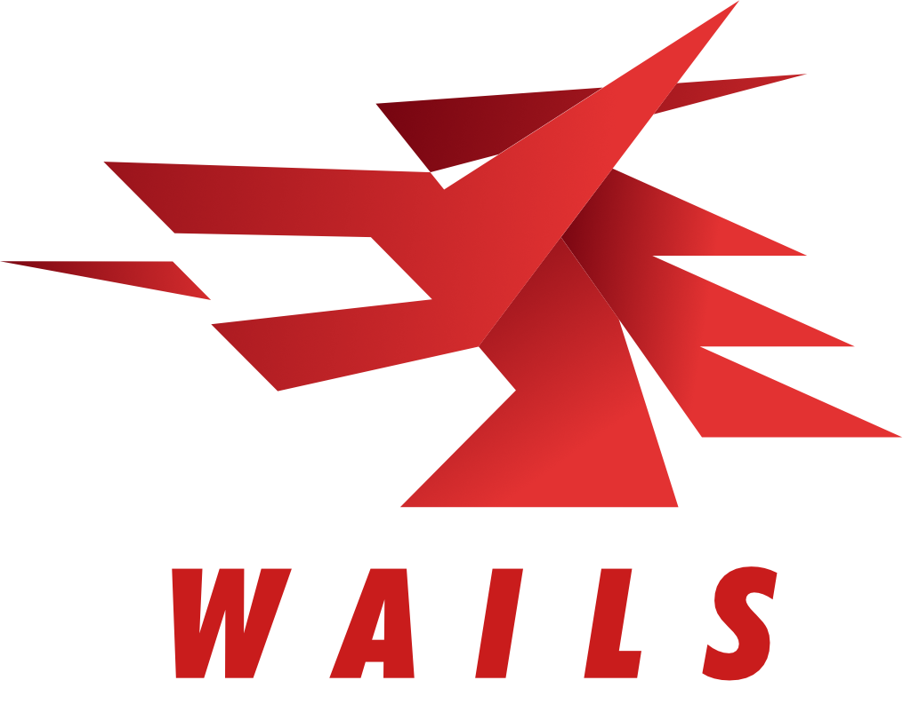

# Postwoman

<p align="center">
  
</p>

**Postwoman** is a fast, open-source API client for developers and teams. It combines the
functionality of tools like Postman with the speed and simplicity of a lightweight desktop
app — wrapped in a single native binary with a modern React + TypeScript frontend.

## Features

- **Powerful HTTP client** — send `GET` through `TRACE` requests with full control over
  query parameters, headers, cookies, bodies (JSON, XML, text, HTML, form-data, URL-encoded,
  binary, GraphQL) and auth (Basic, Bearer, API Key, OAuth2, JWT, OAuth1, AWS SigV4, Digest).
- **Environments & variables** — scoped environment variables (global, collection, folder,
  request), secrets with masking, dynamic variables, and variable resolution.
- **Collections & folders** — organize requests into nested collections with folders.
- **Request editor** — syntax-aware URL/method bar, key/value editors, body modes, GraphQL
  envelope, and pre-request / post-response script editors.
- **Response viewer** — pretty JSON / XML / HTML / text / binary views, headers, cookies,
  status, timing, size, search, copy/download/save.
- **Scripting & runner** — JavaScript sandbox via [goja](https://github.com/dop251/goja) with
  Postman-style `pm` API (pre-request, post-response, assertions, variables, `pm.sendRequest`).
- **WebSocket client**, **Mock server** (local configurable routes with request logs).
- **History** — every executed request recorded with response details.
- **Import / Export** — Postman 2.0/2.1, OpenAPI, cURL, and more; full round-trip preservation.
- **Cross-cutting** — redirect handling, proxies, TLS, timeouts, cancellation, context propagation.

## Tech Stack

| Layer | Technology |
| --- | --- |
| Backend | [Wails v2](https://wails.io/) (Go 1.27), SQLite via [goose](https://github.com/pressly/goose) migrations, zerolog, gorilla/websocket |
| Frontend | [React 19](https://react.dev/), [TypeScript](https://www.typescriptlang.org/), [Vite](https://vite.dev/), [Tailwind CSS](https://tailwindcss.com/), [Radix UI](https://www.radix-ui.com/), [Zustand](https://zustand.docs.pmnd.rs/) |
| Scripting | [goja](https://github.com/dop251/goja) (JavaScript sandbox) |
| Runtime | Desktop via Wails (AppImage, Windows, macOS, Linux) |

## Getting Started

### Prerequisites

- [Go](https://go.dev/) 1.27+
- [Node.js](https://nodejs.org/) + npm
- [Wails v2 CLI](https://wails.io/docs/install): `npm install -g @wailsapp/cli`
- For Linux desktop: [GTK](https://wails.io/docs/install/linux) runtime libraries

### Development

```bash
# Install dependencies and run in dev mode
wails dev
```

The app opens at `http://localhost:34115` with hot-reloading of the frontend.

### Build

```bash
# Build a redistributable production package
wails build
```

This produces an AppImage on Linux, an NSIS installer on Windows, and an app bundle on macOS.

## Project Structure

```
Postwoman/
├── app.go                     # Wails application entry points / backend bindings
├── main.go                    # Wails application bootstrap
├── internal/
│   ├── database/              # SQLite layer (migrations, repository, queries)
│   ├── httpclient/            # HTTP client engine
│   ├── scripting/             # JS sandbox (goja) & scripts
│   ├── collections/           # Collections & folders management
│   ├── variables/             # Variable resolution & scoping
│   ├── websocket/             # WebSocket manager
│   ├── mockserver/            # Mock server
│   ├── runner/                # Collection runner
│   ├── importexport/          # cURL / Postman / OpenAPI import-export
│   ├── httpclient/            # HTTP client internals
│   └── model/                 # Shared models
├── frontend/                  # React + TypeScript + Vite + Tailwind app
├── docs/                      # Audit & implementation plans
└── AppDir/                    # Linux desktop packaging assets
```

## Roadmap

See [`docs/IMPLEMENTATION_PLAN.md`](docs/IMPLEMENTATION_PLAN.md) for the ordered work plan.
Current audit findings are tracked in [`docs/FEATURE_AUDIT.md`](docs/FEATURE_AUDIT.md).

## License

TBD

## Acknowledgements

- [Wails](https://wails.io/) for the Go + desktop bridge
- [Postman](https://www.postman.com/) for API testing inspiration
- The open-source community tooling that makes this possible
